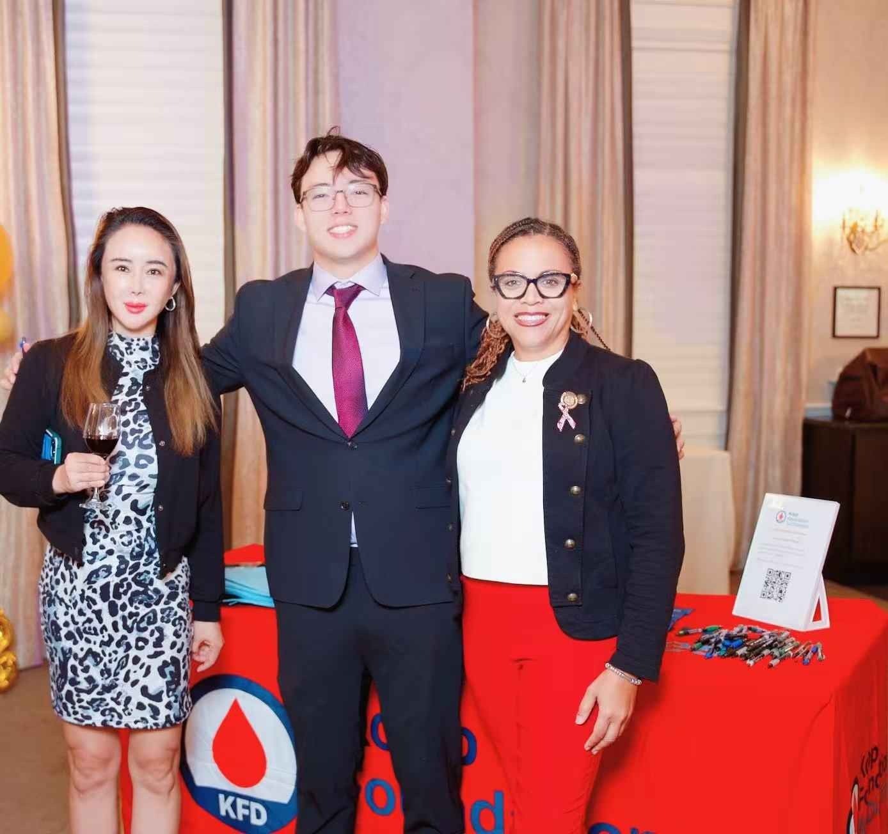
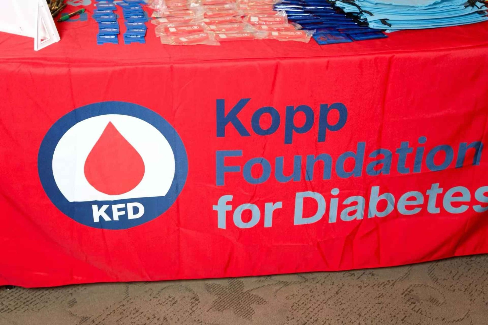
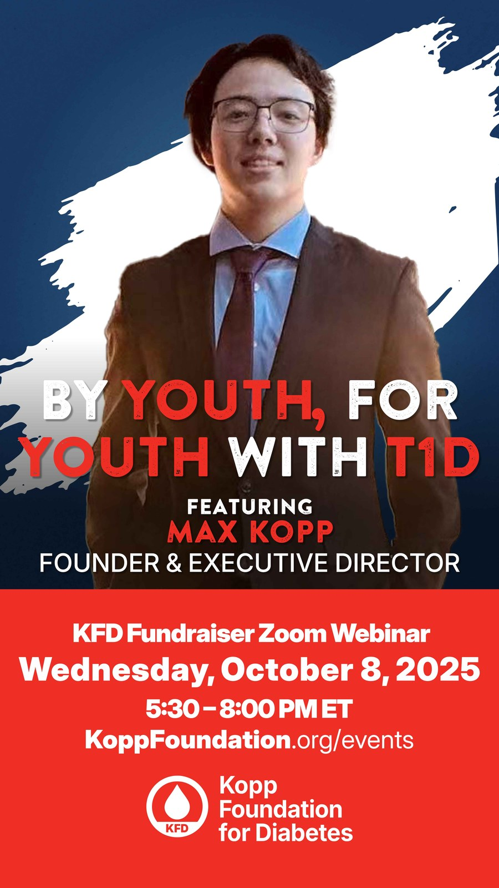
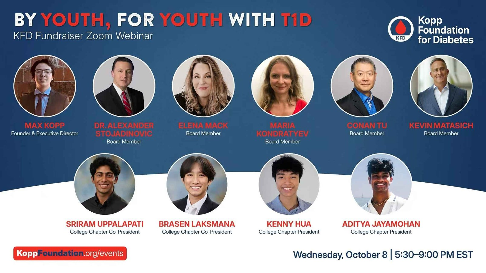
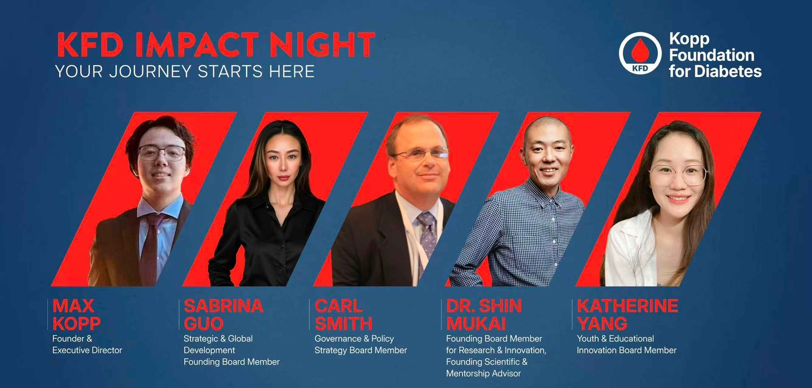
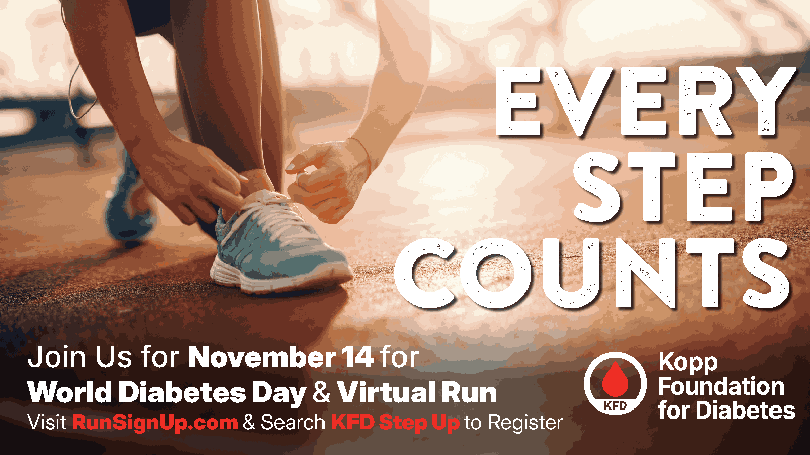

# Kopp Foundation for Diabetes

**501(c)(3) nonprofit advancing Type 1 Diabetes equity and education**

[(3)-Active-green)]()

## Mission

The Kopp Foundation for Diabetes (KFD) is a youth-led nonprofit dedicated to advancing equity, education, and innovation in the Type 1 Diabetes community. We connect young people to research opportunities, provide mentorship, and drive awareness through community outreach. KFD is an independent 501(c)(3), guided by an eight-member board.

## Impact

| Metric | Number |
|--------|--------|
| University Chapters | **12** |
| Volunteers Nationwide | **2,000+** |
| Students Reached | **15,000+** |
| Board | **Eight-member board** |

### Chapter Network

UCLA, UCSD, University of Pittsburgh, Temple University, UMass Amherst, USC, University of Michigan, University of Washington, Arizona State University, Drexel University, and growing.

## Programs

### By Youth, For Youth
Community outreach campaign reaching 15,000+ students through workshops, mentorship, and digital programming. Designed to empower young people affected by Type 1 Diabetes.

### KFD Research Fellows Program
Connects high school and college students to biomedical research mentors, providing pathways into diabetes technology and healthcare innovation.

### Hospital & Industry Partnerships
Collaborations with hospitals, researchers, and biotech companies to promote early-stage innovation and family support services.

## Figures

Photographs and event graphics below are from the [Kopp Foundation for Diabetes gallery](https://maxkopptech.com/pgc_simply_gallery/kopp-foundation-for-diabetes/) on maxkopptech.com. Captions follow the text printed on each graphic or describe only what is visible in the photograph. These images are included for context; they do not change the impact figures listed above.

*Photograph of four people standing at a table with Kopp Foundation for Diabetes branding, from the foundation gallery on maxkopptech.com.*

*Photograph of six people standing at a Kopp Foundation for Diabetes table, from the foundation gallery on maxkopptech.com.*

*Photograph of three people at a Kopp Foundation for Diabetes table with a QR-code stand, from the foundation gallery on maxkopptech.com.*

*Photograph of a table covered with a Kopp Foundation for Diabetes tablecloth and branded materials, from the foundation gallery on maxkopptech.com.*

*Event poster from the site: “By Youth, For Youth With T1D,” featuring Max Kopp, Founder & Executive Director, for a KFD Fundraiser Zoom Webinar on Wednesday, October 8, 2025, 5:30–8:00 PM ET, with the URL KoppFoundation.org/events.*

*Event poster from the site for the same “By Youth, For Youth With T1D” KFD Fundraiser Zoom Webinar, listing the named speakers printed on the graphic (Max Kopp, board members, and college chapter officers) and the time as printed: Wednesday, October 8, 5:30–9:00 PM EST.*

*Promotional graphic titled “KFD Impact Night,” naming, as printed: Max Kopp, Founder & Executive Director; Sabrina Guo; Carl Smith; Dr. Shin Mukai; and Katherine Yang, with the roles printed on the graphic. This is a site graphic, not a complete board roster.*

*Event poster from the site: “Every Step Counts,” inviting people to join on November 14 for World Diabetes Day & Virtual Run, with registration via RunSignUp.com searching “KFD Step Up.”*

## Get Involved

- **Start a Chapter:** Bring KFD to your university
- **Volunteer:** Join our nationwide network
- **Partner:** Research and industry collaboration inquiries welcome

## Contact

- **Website:** [koppfoundation.org](https://www.koppfoundation.org)
- **Founder:** Maximilian Kopp — [maxkopp2007@gmail.com](mailto:maxkopp2007@gmail.com) | [maxkopptech.com](https://www.maxkopptech.com) | [LinkedIn](https://www.linkedin.com/in/maxkopp)
